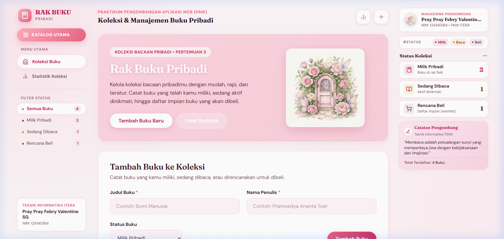
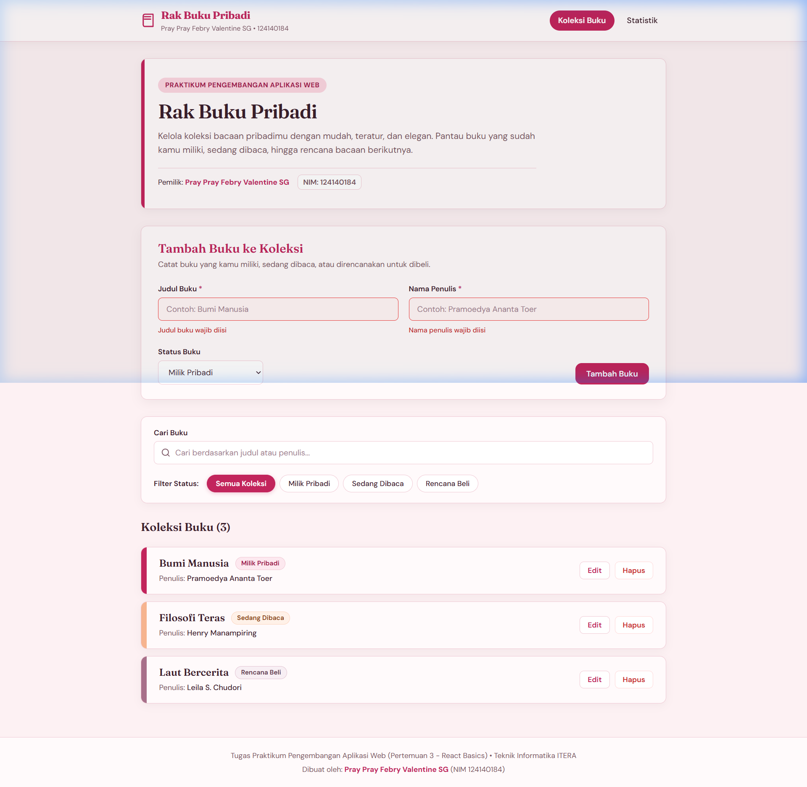
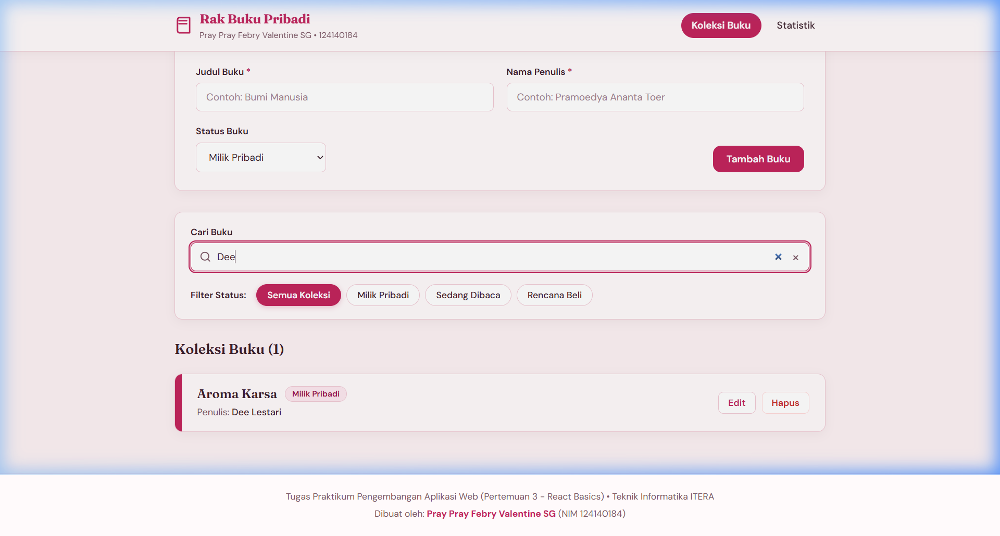
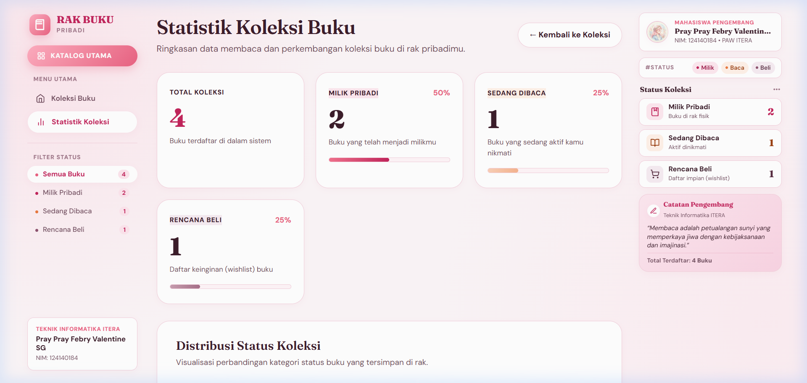

# Aplikasi Manajemen Buku Pribadi

> **Tugas Praktikum Pengembangan Aplikasi Web (Pertemuan 3 - React Basics)**  
> **Program Studi Teknik Informatika, Institut Teknologi Sumatera (ITERA)**  
> **Pemilik:** Pray Pray Febry Valentine SG  
> **NIM:** 124140184  
> **Nama Folder / Repository:** `Pray Febry Valentine SG_124140184_Pertemuan3`  

---

## 1. Deskripsi Aplikasi

**Aplikasi Manajemen Buku Pribadi** adalah aplikasi web berbasis React yang dirancang sebagai rak buku digital pribadi yang hangat, elegan, dan fungsional. Aplikasi ini mempermudah pengguna dalam mencatat, mengorganisasi, dan memantau progres koleksi bacaan mereka.

### Fitur Utama:
- **Tambah Buku Baru**: Mencatat judul, nama penulis, dan status buku (*Milik Pribadi*, *Sedang Dibaca*, atau *Rencana Beli*).
- **Edit & Perbarui Koleksi**: Memperbarui informasi buku yang sudah ada dengan formulir yang otomatis terisi dan fokus interaktif.
- **Hapus Buku dengan Konfirmasi**: Dialog konfirmasi sebelum buku dihapus untuk mencegah kehilangan data tanpa sengaja.
- **Filter Berdasarkan Status**: Memilah koleksi berdasarkan status (*Semua Koleksi*, *Milik Pribadi*, *Sedang Dibaca*, *Rencana Beli*).
- **Pencarian Cepat (Case-Insensitive)**: Mencari buku berdasarkan judul atau nama penulis secara instan tanpa peka huruf besar/kecil.
- **Penyimpanan Permanen (localStorage)**: Semua perubahan data tersimpan otomatis di peramban dan tetap ada setelah halaman dimuat ulang (*reload*), dilengkapi proteksi *try/catch* terhadap JSON corrupt.
- **Validasi Formulir Ketat**: Menolak input kosong atau input yang hanya berisi spasi (*whitespace*), menampilkan tanda visual border merah dan pesan error tepat di bawah kolom yang bermasalah.
- **Pesan Ramah (*Friendly Empty State*)**: Tampilan informatif saat rak buku masih kosong atau saat hasil pencarian tidak ditemukan.
- **Halaman Statistik**: Halaman khusus yang memvisualisasikan ringkasan data, jumlah buku tiap kategori, dan persentase distribusi koleksi dengan *progress bar*.
- **Desain Feminin & Hangat**: Palet warna bernuansa *blush* (`#fdf1f3`), kartu *warm white* (`#fffafb`), tipografi *Fraunces* (serif elegan) & *DM Sans*, serta motif visual "punggung buku" (*book spine*) di sisi kiri tiap item.

---

## 2. Instalasi dan Cara Menjalankan

### Prasyarat
- Node.js (versi 18 atau lebih baru)
- npm (Node Package Manager)

### Langkah-langkah Menjalankan:

> **Catatan:** Seluruh perintah di bawah ini dijalankan langsung di direktori utama project (`Pray Febry Valentine SG_124140184_Pertemuan3`).

1. **Instal seluruh dependensi**:
   ```bash
   npm install
   ```

2. **Menjalankan server pengembangan (*Development Server*)**:
   ```bash
   npm run dev
   ```
   Buka peramban di alamat: `http://localhost:5173/`

3. **Menjalankan pengujian otomatis (*Unit Testing*)**:
   ```bash
   npm test
   ```

4. **Memeriksa kualitas kode (*Linter*)**:
   ```bash
   npm run lint
   ```

5. **Membangun bundle produksi (*Build Production*)**:
   ```bash
   npm run build
   ```

---

## 3. Tangkapan Layar (Screenshots)

Berikut adalah dokumentasi visual antarmuka aplikasi yang diambil langsung saat pengujian berjalan:

### A. Halaman Beranda (Koleksi Buku & Formulir)


### B. Validasi Formulir (Border Merah & Pesan Error)


### C. Pencarian & Filter Koleksi


### D. Halaman Statistik Koleksi


---

## 4. Penjelasan Fitur & Konsep React yang Digunakan

| Konsep React | Penjelasan Implementasi | Lokasi File |
| :--- | :--- | :--- |
| **`useState`** | Digunakan untuk mengelola state lokal form (`title`, `author`, `status`, `errors`), filter aktif, kata kunci pencarian, serta state sinkronisasi di custom hook. | [`src/components/BookForm/BookForm.jsx`](src/components/BookForm/BookForm.jsx)<br>[`src/components/BookFilter/BookFilter.jsx`](src/components/BookFilter/BookFilter.jsx)<br>[`src/hooks/useLocalStorage.js`](src/hooks/useLocalStorage.js) |
| **`useEffect`** | Digunakan untuk sinkronisasi nilai ke `localStorage` saat ada perubahan data di luar storage, serta mengarahkan fokus kursor ke input judul secara otomatis saat beralih ke mode edit. | [`src/hooks/useLocalStorage.js`](src/hooks/useLocalStorage.js)<br>[`src/components/BookForm/BookForm.jsx`](src/components/BookForm/BookForm.jsx) |
| **Context API (`useContext`)** | Menyediakan state global buku, fungsi CRUD (`addBook`, `editBook`, `deleteBook`), filter status, query pencarian, serta custom hook pembungkus `useBooks()`. | [`src/context/BookContext.jsx`](src/context/BookContext.jsx) |
| **React Router** | Mengatur navigasi halaman SPA tanpa reload peramban menggunakan `BrowserRouter`, `Routes`, `Route`, `NavLink`, dan menangani rute tidak dikenal (404 Page). | [`src/App.jsx`](src/App.jsx) |
| **Custom Hooks** | - `useLocalStorage`: State persisten tersinkronisasi `localStorage` dengan penanganan aman JSON rusak (*try/catch*).<br>- `useBookStats`: Kalkulasi cerdas total koleksi, jumlah per status, dan persentase proporsi. | [`src/hooks/useLocalStorage.js`](src/hooks/useLocalStorage.js)<br>[`src/hooks/useBookStats.js`](src/hooks/useBookStats.js) |
| **PropTypes** | Validasi tipe data ketat pada semua props komponen, termasuk bentuk (*shape*) objek buku untuk mencegah kesalahan tipe data (*type safety*). | [`src/components/BookForm/BookForm.jsx`](src/components/BookForm/BookForm.jsx)<br>[`src/components/BookList/BookList.jsx`](src/components/BookList/BookList.jsx)<br>[`src/components/BookFilter/BookFilter.jsx`](src/components/BookFilter/BookFilter.jsx)<br>[`src/context/BookContext.jsx`](src/context/BookContext.jsx) |
| **Controlled Components** | Seluruh input teks, dropdown status, dan form dikontrol oleh React state melalui properti `value` dan `onChange`. | [`src/components/BookForm/BookForm.jsx`](src/components/BookForm/BookForm.jsx)<br>[`src/components/BookFilter/BookFilter.jsx`](src/components/BookFilter/BookFilter.jsx) |
| **Key pada List** | Properti `key={book.id}` diberikan secara unik pada setiap iterasi kartu buku agar algoritma rekonsiliasi React efisien saat update/delete. | [`src/components/BookList/BookList.jsx`](src/components/BookList/BookList.jsx) |
| **Conditional Rendering** | Merender tampilan kondisional: pesan error validasi di bawah input, tombol Edit vs Batal/Tambah, kondisi rak kosong vs pencarian nihil, dan rute fallback 404. | [`src/components/BookForm/BookForm.jsx`](src/components/BookForm/BookForm.jsx)<br>[`src/components/BookList/BookList.jsx`](src/components/BookList/BookList.jsx)<br>[`src/pages/Stats/Stats.jsx`](src/pages/Stats/Stats.jsx)<br>[`src/App.jsx`](src/App.jsx) |

---

## 5. Daftar Pengujian Otomatis (Unit Testing)

Pengujian dibangun menggunakan **Vitest** dan **React Testing Library** (`@testing-library/react`) dengan environment `jsdom`:

| No | File Pengujian | Komponen / Hook | Deskripsi yang Diuji | Status |
| :---: | :--- | :--- | :--- | :---: |
| 1 | `BookForm.test.jsx` | `BookForm` | Menampilkan pesan error saat judul atau penulis kosong / hanya berisi spasi, dan memastikan error hilang seketika saat input diperbaiki. | **LULUS (Passed)** |
| 2 | `BookForm.test.jsx` | `BookForm` | Memanggil handler submit dengan data objek buku yang benar (dan ter-trim) saat input valid, serta me-reset formulir. | **LULUS (Passed)** |
| 3 | `BookList.test.jsx` | `BookList` & `BookItem` | Menampilkan daftar buku beserta lencana status dan punggung buku dengan benar, serta menampilkan pesan ramah saat daftar kosong. | **LULUS (Passed)** |
| 4 | `BookFilter.test.jsx` | `BookFilter` | Memanggil fungsi perubahan filter saat tombol status diklik dan memanggil handler pencarian saat input diketik. | **LULUS (Passed)** |
| 5 | `useBookStats.test.jsx` | `useBookStats` | Menghitung total koleksi, jumlah buku per status (*milik*, *baca*, *beli*), dan persentase tiap status secara akurat tanpa *division by zero* / NaN. | **LULUS (Passed)** |
| 6 | `useLocalStorage.test.jsx` | `useLocalStorage` | Membaca nilai awal, menyimpan nilai baru ke `window.localStorage`, serta aman terhadap data JSON rusak (*corrupt JSON fallback*). | **LULUS (Passed)** |

Hasil eksekusi `npm test` disimpan pada file [`docs/laporan-testing.txt`](docs/laporan-testing.txt).

---

## 6. Identitas Pembuat

- **Nama**: Pray Pray Febry Valentine SG  
- **NIM**: 124140184  
- **Mata Kuliah**: Praktikum Pengembangan Aplikasi Web (PAW)  
- **Program Studi**: Teknik Informatika  
- **Institusi**: Institut Teknologi Sumatera (ITERA)  
- **Tahun**: 2026  
