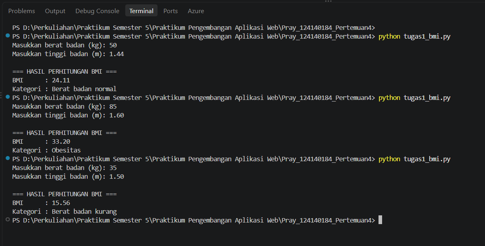
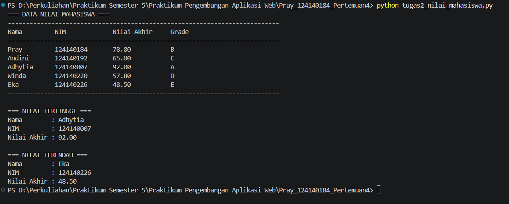
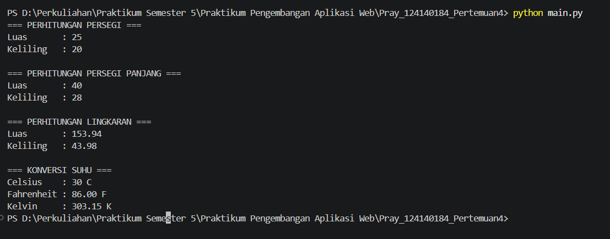

# Praktikum Pengembangan Aplikasi Web (Pertemuan 4 - Python Dasar)

> **Tugas Praktikum Pengembangan Aplikasi Web**  
> **Program Studi Teknik Informatika — Institut Teknologi Sumatera (ITERA)**  
> **Tahun Ajaran 2024/2025**

---

## Identitas Mahasiswa

| Informasi | Keterangan |
| :--- | :--- |
| **Nama** | Pray Febry Valentine SG |
| **NIM** | 124140184 |
| **Program Studi** | Teknik Informatika |
| **Mata Kuliah** | Praktikum Pengembangan Aplikasi Web |
| **Pertemuan** | 4 (Dasar Pemrograman Python) |
| **Repository / Direktori** | `Pray Febry Valentine SG_124140184_Pertemuan4` |

---

## Deskripsi Singkat Program & Alur Kerja

Praktikum Pertemuan 4 ini berfokus pada penguasaan konsep dasar pemrograman Python, yang mencakup variabel, tipe data, operator aritmatika, percabangan (`if-elif-else`), struktur data (`list` dan `dictionary`), perulangan (`for`), pendefinisian fungsi berparameter dengan nilai kembalian (*return value*), dokumentasi *docstring*, serta modularisasi kode melalui pembuatan dan pengimporan modul internal.

Berikut adalah rincian alur kerja dan fungsi pada masing-masing berkas tugas:

### 1. Soal 1: Program Penghitung BMI (`tugas1_bmi.py`)

* **Alur Kerja**:
  1. Pengguna memasukkan berat badan dalam satuan kilogram (kg) dan tinggi badan dalam satuan meter (m) melalui input terminal.
  2. Program mengonversi input menjadi tipe data desimal (`float`).
  3. Nilai *Body Mass Index* (BMI) dihitung menggunakan rumus matematis:
     $$\text{BMI} = \frac{\text{berat}}{(\text{tinggi})^2}$$
  4. Nilai BMI dievaluasi menggunakan struktur kendali percabangan `if-elif-else` untuk menentukan kategori berat badan:
     * $\text{BMI} < 18.5$: **Berat badan kurang**
     * $18.5 \le \text{BMI} < 25.0$: **Berat badan normal**
     * $25.0 \le \text{BMI} < 30.0$: **Berat badan berlebih**
     * $\text{BMI} \ge 30.0$: **Obesitas**
  5. Program menampilkan hasil perhitungan nilai BMI (dibulatkan menjadi 2 angka di belakang koma) beserta kategori status berat badan.

* **Fungsi pada Berkas**:
  * `hitung_bmi(berat, tinggi)`: Menerima parameter `berat` (kg) dan `tinggi` (m), lalu mengembalikan nilai kalkulasi BMI.
  * `tentukan_kategori_bmi(bmi)`: Menerima parameter nilai `bmi`, lalu mengembalikan string kategori berat badan.
  * `main()`: Mengorkestrasi penerimaan input pengguna, pemanggilan fungsi kalkulasi, dan pencetakan hasil ke terminal.

---

### 2. Soal 2: Program Pengelolaan Data Nilai Mahasiswa (`tugas2_nilai_mahasiswa.py`)

* **Alur Kerja**:
  1. Data mahasiswa diinisialisasi dalam bentuk kumpulan dictionary di dalam sebuah list (`list of dictionaries`), masing-masing berisi field `nama`, `nim`, `nilai_uts`, `nilai_uas`, dan `nilai_tugas`.
  2. Program mengiterasi setiap data mahasiswa untuk menghitung nilai akhir dengan bobot penilaian resmi:
     $$\text{Nilai Akhir} = (30\% \times \text{UTS}) + (40\% \times \text{UAS}) + (30\% \times \text{Tugas})$$
  3. Nilai akhir kemudian dikonversi menjadi *grade* huruf kelulusan:
     * $\text{Nilai Akhir} \ge 80$: **A**
     * $70 \le \text{Nilai Akhir} < 80$: **B**
     * $60 \le \text{Nilai Akhir} < 70$: **C**
     * $50 \le \text{Nilai Akhir} < 60$: **D**
     * $\text{Nilai Akhir} < 50$: **E**
  4. Program mencetak tabel seluruh data mahasiswa secara rapi ke layar terminal menggunakan format string rata kiri (`<`) dan presisi dua desimal (`.2f`).
  5. Menggunakan *built-in function* Python `max()` dan `min()` dengan ekspresi `lambda`, program mengekstrak serta menampilkan mahasiswa dengan perolehan nilai akhir tertinggi dan terendah.

* **Fungsi pada Berkas**:
  * `hitung_nilai_akhir(nilai_uts, nilai_uas, nilai_tugas)`: Menghitung nilai akhir gabungan berdasarkan persentase bobot masing-masing komponen.
  * `tentukan_grade(nilai_akhir)`: Mengonversi nilai akhir numerik ke dalam bentuk grade huruf (A–E).
  * `proses_data_mahasiswa(daftar_mahasiswa)`: Menghitung dan menyematkan atribut `nilai_akhir` dan `grade` ke setiap dictionary mahasiswa.
  * `tampilkan_tabel_mahasiswa(daftar_mahasiswa)`: Mencetak tabel data nilai mahasiswa yang tersusun rapi.
  * `tampilkan_ekstrem_nilai(daftar_mahasiswa)`: Mencari dan menampilkan mahasiswa dengan perolehan nilai tertinggi dan terendah.
  * `main()`: Titik masuk utama eksekusi program.

---

### 3. Soal 3: Modul Matematika Python & Program Utama (`math_operations.py` dan `main.py`)

* **Alur Kerja**:
  1. Berkas `math_operations.py` dirancang sebagai modul mandiri (*custom module*) yang menyimpan konstanta $\pi$ (`PI = 3.14159`), fungsi perhitungan geometri bangun datar (persegi, persegi panjang, lingkaran), serta fungsi konversi temperatur suhu.
  2. Berkas `main.py` bertindak sebagai berkas eksekusi utama yang mendemonstrasikan 2 cara pengimporan modul Python:
     * `import math_operations`: Mengimpor seluruh modul dan memanggil fungsinya menggunakan prefiks nama modul.
     * `from math_operations import celsius_ke_fahrenheit, celsius_ke_kelvin`: Mengimpor fungsi spesifik secara langsung ke namespace lokal.
  3. Berkas `main.py` mendefinisikan nilai uji (`sisi = 5`, `panjang = 10`, `lebar = 4`, `jari_jari = 7`, `suhu = 30`), memanggil setiap fungsi terkait, dan menampilkan hasil komputasi secara terstruktur.

* **Fungsi pada Modul `math_operations.py`**:
  * `luas_persegi(sisi)`: Menghitung luas persegi ($sisi \times sisi$).
  * `keliling_persegi(sisi)`: Menghitung keliling persegi ($4 \times sisi$).
  * `luas_persegi_panjang(panjang, lebar)`: Menghitung luas persegi panjang ($panjang \times lebar$).
  * `keliling_persegi_panjang(panjang, lebar)`: Menghitung keliling persegi panjang ($2 \times (panjang + lebar)$).
  * `luas_lingkaran(jari_jari)`: Menghitung luas lingkaran ($\pi \times r^2$).
  * `keliling_lingkaran(jari_jari)`: Menghitung keliling lingkaran ($2 \times \pi \times r$).
  * `celsius_ke_fahrenheit(celsius)`: Mengonversi suhu dari Celsius ke Fahrenheit ($(\frac{9}{5} \times C) + 32$).
  * `celsius_ke_kelvin(celsius)`: Mengonversi suhu dari Celsius ke Kelvin ($C + 273.15$).

---

## Instruksi Cara Menjalankan Program di Terminal

### Prasyarat
Pastikan Python 3 telah terpasang pada komputer Anda. Untuk memastikan instalasi:
```bash
python --version
```

### Langkah Menjalankan Skrip:

Buka terminal (Command Prompt, PowerShell, atau Terminal VS Code), lalu pastikan posisi direktori aktif berada pada folder `Pray Febry Valentine SG_124140184_Pertemuan4`:
```bash
cd Pray Febry Valentine SG_124140184_Pertemuan4
```

#### A. Menjalankan Soal 1 (Program Penghitung BMI)
Jalankan perintah berikut:
```bash
python tugas1_bmi.py
```
*Program akan meminta input berat badan (kg) dan tinggi badan (m) secara interaktif, kemudian mencetak hasil perhitungan BMI beserta kategorinya.*

#### B. Menjalankan Soal 2 (Program Pengelolaan Nilai Mahasiswa)
Jalankan perintah berikut:
```bash
python tugas2_nilai_mahasiswa.py
```
*Program akan langsung memproses data nilai 5 mahasiswa, menampilkan tabel terformat, serta mencantumkan nama mahasiswa dengan nilai tertinggi dan terendah.*

#### C. Menjalankan Soal 3 (Program Utama Modul Matematika)
Jalankan perintah berikut:
```bash
python main.py
```
*Program `main.py` akan memanggil fungsi dari `math_operations.py` dan mencetak hasil perhitungan persegi, persegi panjang, lingkaran, serta konversi suhu Celsius ke Fahrenheit dan Kelvin.*

---

## Screenshot Bukti Hasil Eksekusi Terminal

Berikut adalah tangkapan layar bukti eksekusi masing-masing program di terminal VS Code:

### 1. Screenshot Hasil Eksekusi Soal 1 (`tugas1_bmi.py`)

*Keterangan: Menampilkan 3 pengujian dengan variasi input: (1) Berat 50 kg, Tinggi 1.44 m $\rightarrow$ BMI 24.11 (Normal); (2) Berat 85 kg, Tinggi 1.60 m $\rightarrow$ BMI 33.20 (Obesitas); (3) Berat 35 kg, Tinggi 1.50 m $\rightarrow$ BMI 15.56 (Kurang).*

---

### 2. Screenshot Hasil Eksekusi Soal 2 (`tugas2_nilai_mahasiswa.py`)

*Keterangan: Menampilkan tabel komputasi nilai akhir dan grade untuk 5 mahasiswa (Pray, Andini, Adhytia, Winda, Eka), diikuti informasi mahasiswa dengan nilai akhir tertinggi (Adhytia - 92.00) dan nilai terendah (Eka - 48.50).*

---

### 3. Screenshot Hasil Eksekusi Soal 3 (`main.py` & `math_operations.py`)

*Keterangan: Menampilkan hasil pemanggilan fungsi modul matematika untuk perhitungan bangun datar (persegi sisi 5, persegi panjang $10 \times 4$, lingkaran r 7) serta konversi suhu ($30^\circ\text{C} = 86.00^\circ\text{F} = 303.15\text{ K}$).*

---

## Dokumentasi Kode (Docstring pada Setiap Fungsi)

Setiap fungsi dalam program ini dilengkapi dengan komentar dokumentasi (*docstring*) standar PEP 257 yang menjelaskan kegunaan fungsi, parameter input (beserta tipe dan maknanya), serta nilai kembalian (*return value*).

### Rincian Tabel Fungsi, Parameter Input, dan Nilai Kembalian:

| File | Nama Fungsi | Parameter Input | Nilai Kembalian (*Return Value*) | Deskripsi Singkat |
| :--- | :--- | :--- | :--- | :--- |
| `tugas1_bmi.py` | `hitung_bmi` | `berat` (`float`), `tinggi` (`float`) | `float` | Menghitung indeks massa tubuh $\frac{\text{berat}}{\text{tinggi}^2}$ |
| `tugas1_bmi.py` | `tentukan_kategori_bmi` | `bmi` (`float`) | `str` | Menentukan kategori berat badan |
| `tugas1_bmi.py` | `main` | *Tidak ada* | `None` | Fungsi driver interaktif program BMI |
| `tugas2_nilai_mahasiswa.py` | `hitung_nilai_akhir` | `nilai_uts` (`float/int`), `nilai_uas` (`float/int`), `nilai_tugas` (`float/int`) | `float` | Menghitung akumulasi nilai berbobot ($30\% + 40\% + 30\%$) |
| `tugas2_nilai_mahasiswa.py` | `tentukan_grade` | `nilai_akhir` (`float`) | `str` | Mengonversi nilai numerik ke huruf A/B/C/D/E |
| `tugas2_nilai_mahasiswa.py` | `proses_data_mahasiswa` | `daftar_mahasiswa` (`list of dict`) | `list of dict` | Memperbarui list data mahasiswa dengan nilai akhir & grade |
| `tugas2_nilai_mahasiswa.py` | `tampilkan_tabel_mahasiswa` | `daftar_mahasiswa` (`list of dict`) | `None` | Mencetak tabel nilai mahasiswa ke terminal |
| `tugas2_nilai_mahasiswa.py` | `tampilkan_ekstrem_nilai` | `daftar_mahasiswa` (`list of dict`) | `None` | Mencetak mahasiswa peraih nilai tertinggi dan terendah |
| `tugas2_nilai_mahasiswa.py` | `main` | *Tidak ada* | `None` | Menginisialisasi data dan mengeksekusi pipeline program nilai |
| `math_operations.py` | `luas_persegi` | `sisi` (`float/int`) | `float/int` | Mengembalikan hasil $sisi \times sisi$ |
| `math_operations.py` | `keliling_persegi` | `sisi` (`float/int`) | `float/int` | Mengembalikan hasil $4 \times sisi$ |
| `math_operations.py` | `luas_persegi_panjang` | `panjang` (`float/int`), `lebar` (`float/int`) | `float/int` | Mengembalikan hasil $panjang \times lebar$ |
| `math_operations.py` | `keliling_persegi_panjang` | `panjang` (`float/int`), `lebar` (`float/int`) | `float/int` | Mengembalikan hasil $2 \times (panjang + lebar)$ |
| `math_operations.py` | `luas_lingkaran` | `jari_jari` (`float/int`) | `float` | Mengembalikan hasil $\pi \times r^2$ |
| `math_operations.py` | `keliling_lingkaran` | `jari_jari` (`float/int`) | `float` | Mengembalikan hasil $2 \times \pi \times r$ |
| `math_operations.py` | `celsius_ke_fahrenheit` | `celsius` (`float/int`) | `float` | Mengembalikan hasil $(\frac{9}{5} \times C) + 32$ |
| `math_operations.py` | `celsius_ke_kelvin` | `celsius` (`float/int`) | `float` | Mengembalikan hasil $C + 273.15$ |
| `main.py` | `main` | *Tidak ada* | `None` | Mengeksekusi pengujian fungsi modul matematika |

---

## Kepatuhan Standar Penulisan PEP 8

Seluruh berkas Python dalam tugas ini disusun dengan mematuhi kaidah penulisan standar **PEP 8 (Style Guide for Python Code)**:

1. **Indentasi Konsisten**: Seluruh blok kode menggunakan indentasi tepat **4 spasi** (tanpa tab).
2. **Konvensi Penamaan `snake_case`**:
   * Nama variabel menggunakan huruf kecil bersambung garis bawah (contoh: `nilai_akhir`, `nilai_uts`, `jari_jari`, `daftar_mahasiswa`).
   * Nama fungsi menggunakan huruf kecil bersambung garis bawah (contoh: `hitung_bmi`, `luas_persegi_panjang`, `celsius_ke_kelvin`).
3. **Konvensi Konstanta Huruf Kapital (`UPPER_CASE`)**:
   * Nilai konstanta didefinisikan dengan huruf besar penuh (contoh: `PI = 3.14159` pada `math_operations.py`).
4. **Jarak Antar Fungsi (*Two Blank Lines*)**: Setiap fungsi tingkat teratas (*top-level function*) dipisahkan dengan tepat **2 baris kosong** untuk menjaga kerapian struktur kode.
5. **Spasi di Sekitar Operator & Tanda Baca**:
   * Terdapat spasi tunggal di sekitar operator penugasan (`=`) dan operator biner (`+`, `-`, `*`, `/`).
   * Terdapat spasi setelah tanda koma (contoh: `(panjang, lebar)`) dan tanda titik dua pada dictionary (contoh: `"nama": "Pray"`).
6. **Titik Masuk Eksekusi (*Entry Point*)**: Setiap berkas skrip yang dapat dijalankan secara mandiri menggunakan idiomatik Python standar `if __name__ == "__main__":`.

---

## Struktur Direktori Berkas

```text
Pray Febry Valentine SG_124140184_Pertemuan4/
│
├── screenshots/
│   ├── math_operations.png         # Screenshot eksekusi Soal 3 (main.py)
│   ├── tugas1.png                  # Screenshot eksekusi Soal 1 (tugas1_bmi.py)
│   └── tugas2.png                  # Screenshot eksekusi Soal 2 (tugas2_nilai_mahasiswa.py)
│
├── .gitignore                      # Berkas konfigurasi git ignore (__pycache__ dll)
├── README.md                       # Laporan dokumentasi lengkap praktikum
├── main.py                         # Program utama pemanggil modul math_operations
├── math_operations.py              # Modul custom operasi matematika dan suhu
├── tugas1_bmi.py                   # Program perhitungan BMI dan kategori
└── tugas2_nilai_mahasiswa.py       # Program pengelolaan data dan tabel nilai mahasiswa
```

---

## Kesimpulan

Melalui praktikum Pertemuan 4 ini, mahasiswa berhasil mengimplementasikan fondasi dasar bahasa pemrograman Python, meliputi:
1. Pembuatan program interaktif dengan logika percabangan untuk menghitung dan mengklasifikasikan BMI.
2. Pengelolaan struktur data majemuk (*list of dictionaries*) untuk agregasi data nilai mahasiswa, pencarian nilai ekstrem, dan pemformatan output tabel.
3. Penerapan konsep modularitas dengan memisahkan fungsi kalkulasi ke dalam modul terpisah dan memanggilnya melalui program utama.
4. Penerapan dokumentasi fungsi berbasis *docstring* yang terstruktur serta penulisan kode yang mematuhi standar internasional PEP 8.
